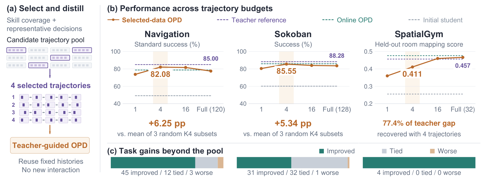
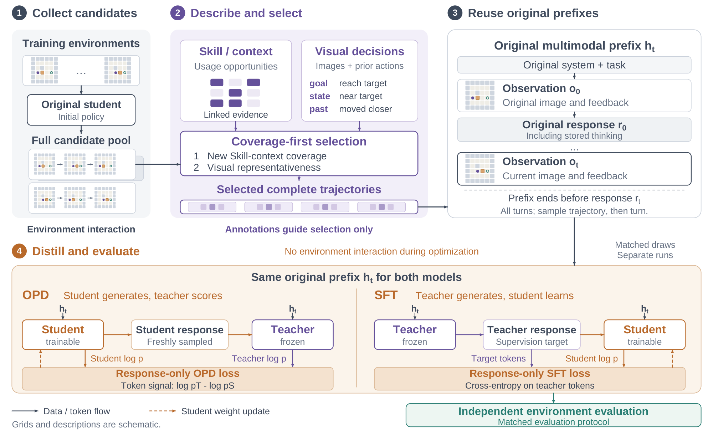

# Visual Agent Distillation

**Distilling Visual Agents from a Few Representative Trajectories**

Adapt a visual agent by reusing a small set of interaction histories. Select complete trajectories, retain their original images and causal prefixes, and transfer a stronger teacher's behavior through fresh student responses. Offline training needs no further environment interaction; the trained agent is evaluated through new interactions.

With **four selected trajectories per environment**, our Qwen3.5-4B student reaches **82.08% on Navigation** and **85.55% on Sokoban**, up from 49.17% and 60.16%. On held-out SpatialGym rooms, the mapping score rises from **0.255 to 0.411**, recovering **77.4% of the measured student–teacher gap**, with improvements in **all four held-out rooms**. This repository contains the training and evaluation implementation, compact trajectory examples, frozen configurations, and measured results.

[Results](#results) · [Method](#method) · [Trajectory examples](#explore-four-real-trajectories) · [Quick start](#quick-start) · [Training](#training-and-evaluation) · [Documentation](#documentation)

> **Release scope:** the code starts from an already selected set of trajectories. Environment adapters, collection, prefix preparation, offline OPD, matched SFT, online OPD, and evaluation are included. The trajectory-selection front end is not released; its precomputed example annotations and choices are available to inspect.



**Figure 1 — Four selected trajectories, broad task transfer.** Reproduced from the paper. K4 outperforms the mean of three random subsets on Navigation and Sokoban; the SpatialGym panel shows **held-out single-room** results and **77.4% teacher-gap recovery**. Curves retain the original student, teacher, online OPD, and larger-data comparisons. Axes are zoomed and trajectory budgets are categorical. Task improvements use four-repeat task means. Results use one training seed; K1/K16 and random-subset endpoints are collaborator-reported. Click the image to view it at full resolution.

## Results

All adapted models below use **100 updates × 64 responses**, with the final model evaluated at **update 100**. The student is **Qwen3.5-4B** and the frozen teacher is **Qwen3.5-27B**. Each evaluation task is repeated four times.

| Model / training method | Navigation standard ↑ | Navigation long-horizon ↑ | Sokoban ↑ | SpatialGym held-out single-room ↑ | SpatialGym two-room ↑ |
|---|---:|---:|---:|---:|---:|
| Original student, 4B | 49.17% | 13.33% | 60.16% | 0.255 | 0.116 |
| Teacher, 27B | 85.00% | 25.00% | 88.28% | 0.457 | 0.378 |
| **Representative K4 OPD** | **82.08%** | **22.08%** | **85.55%** | **0.411** | **0.270** |
| Representative K4 SFT | 74.17% | 20.42% | 76.17% | 0.400 | 0.241 |
| Full-pool OPD | 77.50% | 22.50% | 83.59% | 0.466 | 0.325 |
| Full-pool SFT | 64.17% | 15.42% | 77.73% | 0.424 | 0.283 |
| Online OPD | 78.75% | 21.25% | 85.94% | 0.476 | 0.305 |

Four-trajectory OPD recovers **91.86% of the measured student–teacher gap on standard Navigation**, **90.28% on Sokoban**, and **77.4% on held-out SpatialGym rooms**, where gap recovery is `(adapted − original student) / (teacher − original student)`. The table retains both held-out single-room and two-room SpatialGym results.

Navigation and Sokoban report **binary success rates**. SpatialGym reports its **continuous cognitive-map score**, not a success percentage. The held-out single-room panel is a four-room development split; the two-room panel tests transfer to a different room layout. Navigation long-horizon uses different task configurations in the same simulator scenes.

The candidate pools contain **120 Navigation, 128 Sokoban, and 32 SpatialGym trajectories**. K4 denotes the four retained histories, not the cost of collecting the pool. Results use one training seed; equal response/update counts do not imply equal token or compute costs.

Source: [full-precision results](results/main.json), [five-update monitoring curves](results/learning_curves.csv), and [result definitions](results/README.md). This table uses the released 100-update results; it does not mix in earlier 50-update experiments.

## Method

### From representative histories to fresh supervision



**Figure 2 — Representative trajectory selection and distillation.** Reproduced from the paper. Both training branches consume the same original causal prefixes: OPD resamples student responses and obtains teacher token scores; SFT learns teacher-generated responses. Skill and visual-decision annotations are used only for selection. Observation grids and descriptions in the diagram are schematic examples.

The figure shows the complete research method. Its **“Describe and select” stage is not included in this code release**; the released training code accepts already selected trajectories as an explicit file list. In the full method, selection combines skill–context coverage with ordered visual decision similarity.

1. **Keep complete histories.** Stored student trajectories preserve the observations, images, original responses, and unsuccessful actions. Task failure alone does not exclude a trajectory.
2. **Extract causal prefixes.** A prefix ends at the current observation. Earlier responses and thinking remain; the current response, future observations, and final outcome are excluded.
3. **Replay with new responses.** Sample a trajectory uniformly, then one of its turns uniformly. Offline OPD generates a new student response at that prefix and asks the frozen teacher to score those exact tokens.
4. **Evaluate the adapted policy.** Newly generated actions are executed in the environment during evaluation, where the agent encounters the consequences of its own decisions.

Skill labels and visual decision descriptions guide selection only. **They are not inserted into student or distillation-teacher prompts.** Original image bytes and native multimodal tokenization are retained, and thinking remains enabled.

### Three training paths

| Path | Context | Supervision | Environment interaction during optimization |
|---|---|---|---|
| **Offline OPD** | Replayed visual prefix | Frozen teacher scores the current student's freshly sampled response | No |
| **Matched SFT** | Same ordered prefix draws as OPD | Teacher generates a response for each draw; train on response tokens only | No |
| **Online OPD** | Current context from persistent environment lanes | Frozen teacher scores the student's newly generated and executed response | Yes |

Offline OPD uses native Slime updates with the sampled-token signal

```text
A_t = log p_teacher(y_t | prefix, y_<t)
    − log p_student_old(y_t | prefix, y_<t)
```

Its coefficient is 1, with no environment-reward term or additional reference KL. In SFT, the target is a newly generated teacher response, including thinking; it is not the saved student's historical response. Online OPD uses the native asynchronous worker, 16 persistent environment lanes, bounded policy lag, and importance correction.

See [method and data contracts](docs/METHOD.md) for the exact schemas and [online OPD](docs/ONLINE_OPD.md) for the streaming baseline.

## Explore four real trajectories

The compact Sokoban example contains **four selected trajectories, ten unique prefixes, and their original observation images**. Everything in this section is readable directly on GitHub, without installing packages or running a model.

| [C023](examples/C023.md) · 5 prefixes | [C073](examples/C073.md) · 2 prefixes | [C016](examples/C016.md) · 1 prefix | [C114](examples/C114.md) · 2 prefixes |
|:---:|:---:|:---:|:---:|
|  |  |  |  |

Follow the [walkthrough](docs/WALKTHROUGH.md) to inspect the collected responses, observations, and stored selection records. Compare a [first-turn prefix](data/prefixes/P01.json) with a [prefix containing interaction history](data/prefixes/P02.json).

The examples retain imperfect student behavior. Candidate IDs are anonymized aliases. The other candidate trajectories have compact annotation previews in [data/candidates.json](data/candidates.json); their full histories and image collections are not bundled.

## Environments and evaluation

| Environment | Task and interaction protocol | Final evaluation panels |
|---|---|---|
| **Sokoban** | Visual 6×6 board, one box; 5 turns, up to 3 actions per turn; `wm_think` | 64 maps × 4 repeats = **256 episodes** |
| **Navigation** | AI2-THOR navigation; 30 turns, up to 5 actions per turn; `free_think` | 60 standard tasks and 60 long-horizon tasks, each × 4 = **480 episodes** |
| **SpatialGym** | Explore a scene for 10 steps, then produce a cognitive map | 20 single-room and 20 two-room scenes, each × 4 = **160 episodes** |

The single-room SpatialGym panel is reported separately for 16 training rooms and 4 held-out development rooms. [Frozen panel files](configs/panels/) specify exact task IDs, reset seeds, and evaluation repeats. [Environment protocols](configs/environments/) specify observations, actions, scoring, and asset revisions.

Adapters use pinned VAGEN implementations. Navigation additionally needs AI2-THOR assets and a suitable rendering host; SpatialGym needs its external room dataset. See the [environment deployment guide](docs/ENVIRONMENTS.md).

## Quick start

### 1. Install the lightweight package

Use Python **3.10 or newer**. Run data preparation and checks on a CPU compute node or a workstation with adequate resources.

```bash
git clone https://github.com/elated-sawyer/visual-agent-distillation.git
cd visual-agent-distillation
python -m venv .venv
source .venv/bin/activate
pip install -e '.[test,plots]'
```

The repository name is `visual-agent-distillation`; the Python import package currently remains `mosaic_distill`. Installing the lightweight package does not install Slime, CUDA, model weights, or simulator assets.

### 2. Prepare the bundled replay example

```bash
python scripts/prepare_data.py --demo \
  --recipe configs/sokoban.json \
  --student /path/to/Qwen3.5-4B \
  --updates 2 --batch-size 64 \
  --output outputs/demo-opd
```

This small data-only example produces **4 trajectories → 10 unique prefixes → 128 scheduled draws**. It loads no model and makes no model-service or environment calls. The student path is recorded for a later native-input preflight. Omit `--updates 2 --batch-size 64` to prepare the formal recipe's **6,400 draws**.

```text
outputs/demo-opd/
├── config.json       Model path, recipe, seed, and budgets
├── pool.jsonl        Ten distinct causal multimodal prefixes
└── prefixes.jsonl    Deterministic trajectory/turn sampling schedule
```

Use a new output directory for each preparation command. Preparing these files is not a training run.

### 3. Check the package and reproduce the result plot

```bash
python -m pytest -q tests
python scripts/plot_results.py --output outputs/main-results.pdf
```

The plot uses the committed measured results. [Release validation](docs/VALIDATION.md) records 30 passing CPU tests and the scope of those checks.

## Training and evaluation

GPU training uses a compatible **Slime 0.4.0 / Megatron / SGLang** runtime. It requires local model weights, native multimodal input validation, and deployed inference services. The formal model pairing is Qwen3.5-4B or Qwen3.5-9B with a frozen Qwen3.5-27B teacher; exact revisions are in [configs/models.json](configs/models.json).

| Setting | Formal configuration |
|---|---|
| Updates / response batch | 100 / 64 |
| Learning rate | `1e-6`, constant |
| Optimizer | Adam, betas `(0.9, 0.98)`, weight decay `0.1` |
| Response limit | 32,768 new tokens per turn |
| Sampling | Temperature `1.0`, top-p `1.0`, thinking enabled |
| Training context | Sokoban: 114,688; Navigation: 86,016; SpatialGym: 131,072 |
| Monitoring | Every 5 updates on the configured development panel |
| Final evaluation | Fixed update 100, 4 repeats per task |

The scripts below are entrypoints **after** completing the corresponding runtime and service setup:

| Workflow | Guide | Training entrypoint |
|---|---|---|
| Offline OPD | [Prepare prefixes, validate inputs, and start the teacher](docs/TRAINING.md#opd) | `bash training/train.sh opd RUN_DIR` |
| Matched SFT | [Generate and attach matched teacher labels](docs/TRAINING.md#matched-sft) | `bash training/train.sh sft RUN_DIR` |
| Online OPD | [Prepare persistent environment lanes and live evaluation](docs/ONLINE_OPD.md) | `bash training/train.sh online RUN_DIR` |
| Evaluation | [Collection and environment setup](docs/ENVIRONMENTS.md) / [live monitoring](docs/TRAINING.md#live-monitoring-every-five-updates) | `scripts/collect.py` / `scripts/evaluation_worker.py` |

For your own selected data, provide a JSON list of training-episode paths and the associated image store:

```bash
python scripts/prepare_data.py \
  --episodes /data/selected.json --assets /data/assets \
  --recipe configs/navigation.json \
  --student /models/Qwen3.5-4B --output outputs/navigation-opd
```

Each episode follows the [`mm-episode-v1` schema](docs/METHOD.md#input-schemas). The released recipe uses student-collected histories. The preparation script consumes the supplied list without ranking trajectories or filtering by task success.

Native input validation compares token IDs, image pixels, and visual grids. Overlength prefixes fail visibly rather than being silently truncated. Evaluation checks task/repeat identities and weight consistency; infrastructure failures are not converted to unsuccessful task outcomes.

The default OPD launcher requests **8 actor GPUs + 4 rollout GPUs**, plus **2 separately reserved teacher GPUs**. Device allocation and memory feasibility depend on the deployment. Navigation rendering requires an approved rendering host and the provided supervision guard; the full setup is documented in the guides. Training writes W&B data in offline mode.

## Repository layout

```text
configs/               Training recipes, model revisions, environment protocols
  panels/              Frozen task, seed, and repeat lists
  evaluations/         Live monitoring and final evaluation schedules
assets/figures/        Original paper Figures 1 and 2, reused without redrawing
data/                  Compact trajectory examples and precomputed annotations
examples/              Human-readable trajectory walkthroughs
images/                Original observation images for the released examples
mosaic_distill/        Image storage, causal records, environment adapters, scoring
training/              Native Slime OPD/SFT hooks and asynchronous online OPD
scripts/               Data preparation, collection, evaluation, and plotting
results/               Full-precision results and measured learning curves
tests/                 Lightweight CPU contract checks
integration_tests/     Optional checks requiring a compatible training container
docs/                  Method, training, environment, and validation guides
```

## Documentation

| Document | Contents |
|---|---|
| [Method](docs/METHOD.md) | Causal prefixes, objectives, sampling, and input schemas |
| [Training](docs/TRAINING.md) | Runtime setup, offline OPD, matched SFT, and live evaluation |
| [Environments](docs/ENVIRONMENTS.md) | Collection, simulator assets, frozen panels, and metrics |
| [Online OPD](docs/ONLINE_OPD.md) | Persistent lanes, asynchronous updates, and deployment |
| [Walkthrough](docs/WALKTHROUGH.md) | Four real trajectories and ten replay prefixes |
| [Results](results/README.md) | Experimental definitions and machine-readable evidence |
| [Validation](docs/VALIDATION.md) | Completed release checks and their limits |

## Release status and acknowledgments

This release includes environment and training adapters extracted from the research experiments, plus portable preparation and launch scripts. The extracted package passed CPU contract checks; it has **not been retrained end to end on GPUs as a separate release validation**. Use a deployment-specific preflight before a full run.

The selection front end, full candidate corpora, model checkpoints, and private cluster orchestration are not included. The compact examples expose precomputed selection records, not the selection implementation.

The implementation builds on **Slime, Megatron-LM, SGLang, Transformers, VAGEN, gym-sokoban, AI2-THOR, SpatialGym, and Qwen**. See [third-party sources and notices](THIRD_PARTY.md). A general license for the authors' code has not yet been assigned; upstream licenses remain in effect.
