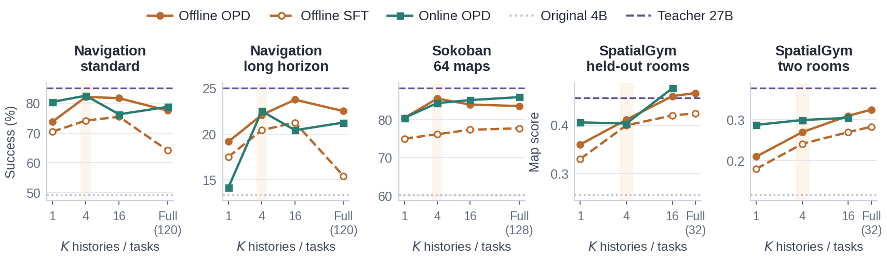
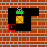
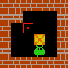
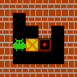
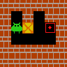

# Visual Agent Distillation

**Distilling Visual Agents from Limited Interaction Experience**

How much interaction experience is needed to distill a capable visual agent? We study two complementary settings: **few-task online OPD**, which generates fresh interactions on a small task catalogue, and **fixed-history offline OPD**, which generates fresh student responses at recorded multimodal prefixes. Representative selection combines skill–context coverage with ordered visual decisions. Only the fixed-history branch needs no environment interaction during optimization.

With **four selected trajectories per environment**, our Qwen3.5-4B student reaches **82.08% on Navigation** and **85.55% on Sokoban**, up from 49.17% and 60.16%, recovering over **90% of the measured student–teacher gap** on these panels. On an independent Navigation panel, replay improves **45.83% → 76.67%**, retaining **91.36% of the same-task online gain**. The study also includes matched SFT, a **9B student**, and supplementary training repetitions.

[Results](#results) · [Method](#method) · [Trajectory examples](#explore-four-real-trajectories) · [Quick start](#quick-start) · [Training](#training-and-evaluation) · [Documentation](#documentation)

> **Included:** environment adapters, collection, prefix preparation, offline OPD, matched SFT, online OPD, and evaluation. Training takes a supplied set of selected trajectories. The selection front end is outside this release; its example annotations and choices are included.


**Figure 1 — Limited interaction experience, broad visual-agent transfer.** Reused from the current paper. Online budgets count tasks with fresh interaction; offline budgets count fixed trajectories. Shading marks task-matched K4. Four trajectories exceed three random subsets' mean by **6.25/5.34 percentage points** on Navigation/Sokoban and recover **77.4% of the teacher gap** on held-out SpatialGym rooms. Lower panels show changes in task-level four-repeat means. Axes are zoomed; budgets are categorical. The [result guide](results/README.md) gives the evaluation protocols and run definitions.

## Results

All adapted models below use **100 updates × 64 responses**, with final evaluation at **update 100** and four repeats per task. The frozen teacher is **Qwen3.5-27B**. The table matches the paper's symmetric **4B/9B** comparison; K4 here always means **offline** training.

| Model / training method | Navigation standard ↑ | Navigation long-horizon ↑ | Sokoban ↑ | SpatialGym held-out single-room ↑ | SpatialGym two-room ↑ |
|---|---:|---:|---:|---:|---:|
| Teacher, 27B (shared) | 85.00% | 25.00% | 88.28% | 0.4566 | 0.3777 |
| **4B · Original student** | 49.17% | 13.33% | 60.16% | 0.2553 | 0.1157 |
| 4B · Full-task online OPD | 78.75% | 21.25% | 85.94% | 0.4763 | 0.3051 |
| 4B · K4 offline SFT | 74.17% | 20.42% | 76.17% | 0.3996 | 0.2413 |
| **4B · K4 offline OPD** | **82.08%** | **22.08%** | **85.55%** | **0.4112** | **0.2700** |
| **9B · Original student** | 67.08% | 25.83% | 64.06% | 0.2790 | 0.2023 |
| 9B · Full-task online OPD | 86.25% | 20.00% | 87.50% | 0.4881 | 0.3212 |
| 9B · K4 offline SFT | 72.92% | 23.75% | 83.20% | 0.4274 | 0.2555 |
| **9B · K4 offline OPD** | **74.17%** | **24.58%** | **87.50%** | **0.4255** | **0.2976** |

The same K4 histories transfer to the 9B student, including **87.50% on Sokoban**, matching its full-task online OPD result. Teacher-gap recovery is `(adapted − original student) / (teacher − original student)`; online-gain retention instead uses the online model in the denominator.

Navigation and Sokoban report **binary success rates**. SpatialGym reports its **continuous cognitive-map score**, not a success percentage. The held-out single-room panel is a four-room development split; the two-room panel tests transfer to a different room layout. Navigation long-horizon uses different task configurations in the same simulator scenes.

The candidate pools contain **120 Navigation, 128 Sokoban, and 32 SpatialGym trajectories**, collected by the original 4B student. K4 denotes retained histories, not total collection cost. Main-table entries are single-run endpoints; four supplementary training repetitions are reported separately. Equal response/update counts do not imply equal token or compute costs.

### Few tasks versus fixed histories



**K is a data/task budget, not the number of training responses.** Each run still learns 6,400 responses. With the same four tasks, online/offline OPD achieves **82.50%/82.08%** on standard Navigation and **84.38%/85.55%** on Sokoban. One online training task already supports substantial transfer; the best budget depends on the environment. Full SpatialGym online training uses all **16 rooms**, while its offline pool contains **32 histories**.

See the [complete result guide](results/README.md) for K1/K4/K16/full-pool tables, independent-panel results, selection controls, training repetitions, and all **480 measured 4B/9B monitoring points**.

## Method

### From representative histories to fresh supervision


**Figure 2 — Representative selection and two uses of interaction experience.** Reproduced from the paper. Fixed-history OPD and matched SFT share original causal prefixes; the online comparison executes responses on selected tasks to refresh histories. K4 task identities match across online and offline training. Annotations enter neither model's training prompt.

Selection combines skill–context coverage with ordered visual decision similarity. The training interface accepts the resulting trajectories as an explicit file list.

1. **Keep complete histories.** Stored student trajectories preserve the observations, images, original responses, and unsuccessful actions. Task failure alone does not exclude a trajectory.
2. **Extract causal prefixes.** A prefix ends at the current observation. Earlier responses and thinking remain; the current response, future observations, and final outcome are excluded.
3. **Replay with new responses.** Sample a trajectory uniformly, then one of its turns uniformly. Offline OPD generates a new student response at that prefix and asks the frozen teacher to score those exact tokens.
4. **Evaluate the adapted policy.** Newly generated actions are executed in the environment during evaluation, where the agent encounters the consequences of its own decisions.

Skill labels and visual decision descriptions guide selection only. **They are not inserted into student or distillation-teacher prompts.** Original image bytes and native multimodal tokenization are retained, and thinking remains enabled.

### Three training paths

| Path | Context | Supervision | Environment interaction during optimization |
|---|---|---|---|
| **Offline OPD** | Replayed visual prefix | Frozen teacher scores the current student's freshly sampled response | No |
| **Matched SFT** | Same ordered prefix draws as OPD | Teacher generates a response for each draw; train on response tokens only | No |
| **Online OPD** | Current context from persistent environment lanes | Frozen teacher scores the student's newly generated and executed response | Yes |

Offline OPD uses native Slime updates with the sampled-token signal

```text
A_t = log p_teacher(y_t | prefix, y_<t)
    − log p_student_old(y_t | prefix, y_<t)
```

Its coefficient is 1, with no environment-reward term or additional reference KL. In SFT, the target is a newly generated teacher response, including thinking; it is not the saved student's historical response. Online OPD uses the native asynchronous worker, 16 persistent environment lanes, bounded policy lag, and importance correction.

See [method and data contracts](docs/METHOD.md) for the selection overview, mathematical definitions, and schemas, and [online OPD](docs/ONLINE_OPD.md) for task budgets and the streaming baseline.

## Explore four real trajectories

The compact Sokoban example contains **four selected trajectories, ten unique prefixes, and their original observation images**. Everything in this section is readable directly on GitHub, without installing packages or running a model.

| [C023](examples/C023.md) · 5 prefixes | [C073](examples/C073.md) · 2 prefixes | [C016](examples/C016.md) · 1 prefix | [C114](examples/C114.md) · 2 prefixes |
|:---:|:---:|:---:|:---:|
|  |  |  |  |

Follow the [walkthrough](docs/WALKTHROUGH.md) to inspect the collected responses, observations, and stored selection records. Compare a [first-turn prefix](data/prefixes/P01.json) with a [prefix containing interaction history](data/prefixes/P02.json).

The examples preserve the original student responses and observations. Candidate IDs are anonymized aliases. [data/candidates.json](data/candidates.json) contains annotation previews for the full candidate pool.

## Environments and evaluation

| Environment | Task and interaction protocol | Final evaluation panels |
|---|---|---|
| **Sokoban** | Visual 6×6 board, one box; 5 turns, up to 3 actions per turn; `wm_think` | 64 maps × 4 repeats = **256 episodes** |
| **Navigation** | AI2-THOR navigation; 30 turns, up to 5 actions per turn; `free_think` | 60 standard tasks and 60 long-horizon tasks, each × 4 = **480 episodes** |
| **SpatialGym** | Explore a scene for 10 steps, then produce a cognitive map | 20 single-room and 20 two-room scenes, each × 4 = **160 episodes** |

The single-room SpatialGym panel is reported separately for 16 training rooms and 4 held-out development rooms. [Frozen panel files](configs/panels/) specify exact task IDs, reset seeds, and evaluation repeats. [Environment protocols](configs/environments/) specify observations, actions, scoring, and asset revisions.

Adapters use pinned VAGEN implementations. Navigation additionally needs AI2-THOR assets and a suitable rendering host; SpatialGym needs its external room dataset. See the [environment deployment guide](docs/ENVIRONMENTS.md).

## Quick start

### 1. Install the lightweight package

Use Python **3.10 or newer**. Run data preparation and checks on a CPU compute node or a workstation with adequate resources.

```bash
git clone https://github.com/elated-sawyer/visual-agent-distillation.git
cd visual-agent-distillation
python -m venv .venv
source .venv/bin/activate
pip install -e '.[test,plots]'
```

The Python import package is `mosaic_distill`. GPU training and simulator setup are described in the guides below.

### 2. Prepare the bundled replay example

```bash
python scripts/prepare_data.py --demo \
  --recipe configs/sokoban.json \
  --student /path/to/Qwen3.5-4B \
  --updates 2 --batch-size 64 \
  --output outputs/demo-opd
```

This data-preparation example produces **4 trajectories → 10 unique prefixes → 128 scheduled draws** and records the student path for training. Omit `--updates 2 --batch-size 64` to prepare the formal recipe's **6,400 draws**.

```text
outputs/demo-opd/
├── config.json       Model path, recipe, seed, and budgets
├── pool.jsonl        Ten distinct causal multimodal prefixes
└── prefixes.jsonl    Deterministic trajectory/turn sampling schedule
```

Use a new output directory for each preparation command, then follow the training instructions below.

### 3. Check the package and reproduce the result plot

```bash
python -m pytest -q tests
python scripts/plot_results.py --output outputs/main-results.pdf
```

The plot uses the committed measured results.

## Training and evaluation

GPU training uses a compatible **Slime 0.4.0 / Megatron / SGLang** runtime. It requires local model weights, native multimodal input validation, and deployed inference services. The formal model pairing is Qwen3.5-4B or Qwen3.5-9B with a frozen Qwen3.5-27B teacher; exact revisions are in [configs/models.json](configs/models.json).

| Setting | Formal configuration |
|---|---|
| Updates / response batch | 100 / 64 |
| Learning rate | `1e-6`, constant |
| Optimizer | Adam, betas `(0.9, 0.98)`, weight decay `0.1` |
| Response limit | 32,768 new tokens per turn |
| Sampling | Temperature `1.0`, top-p `1.0`, thinking enabled |
| Training context | Sokoban: 114,688; Navigation: 86,016; SpatialGym: 131,072 |
| Monitoring | Every 5 updates on the configured development panel |
| Final evaluation | Fixed update 100, 4 repeats per task |

The scripts below are entrypoints **after** completing the corresponding runtime and service setup:

| Workflow | Guide | Training entrypoint |
|---|---|---|
| Offline OPD | [Prepare prefixes, validate inputs, and start the teacher](docs/TRAINING.md#opd) | `bash training/train.sh opd RUN_DIR` |
| Matched SFT | [Generate and attach matched teacher labels](docs/TRAINING.md#matched-sft) | `bash training/train.sh sft RUN_DIR` |
| Online OPD | [Prepare persistent environment lanes and live evaluation](docs/ONLINE_OPD.md) | `bash training/train.sh online RUN_DIR` |
| Evaluation | [Collection and environment setup](docs/ENVIRONMENTS.md) / [live monitoring](docs/TRAINING.md#live-monitoring-every-five-updates) | `scripts/collect.py` / `scripts/evaluation_worker.py` |

For your own selected data, provide a JSON list of training-episode paths and the associated image store:

```bash
python scripts/prepare_data.py \
  --episodes /data/selected.json --assets /data/assets \
  --recipe configs/navigation.json \
  --student /models/Qwen3.5-4B --output outputs/navigation-opd
```

Each episode follows the [`mm-episode-v1` schema](docs/METHOD.md#input-schemas). The released recipe uses student-collected histories. The preparation script consumes the supplied list without ranking trajectories or filtering by task success.

Input validation checks token IDs, image pixels, visual grids, and context length. Evaluation uses the configured task/repeat list and a consistent weight version; infrastructure errors are recorded separately.

The default OPD launcher requests **8 actor GPUs + 4 rollout GPUs**, plus **2 separately reserved teacher GPUs**. Configure GPU allocation for the chosen model and context length. Navigation uses a designated rendering host with the provided supervision guard. Training writes W&B data in offline mode.

## Repository layout

```text
configs/               Training recipes, model revisions, environment protocols
  panels/              Frozen task, seed, and repeat lists
  evaluations/         Live monitoring and final evaluation schedules
assets/figures/        Current paper figures, reused without redrawing
data/                  Compact trajectory examples and precomputed annotations
examples/              Human-readable trajectory walkthroughs
images/                Original observation images for the released examples
mosaic_distill/        Image storage, causal records, environment adapters, scoring
training/              Native Slime OPD/SFT hooks and asynchronous online OPD
scripts/               Data preparation, collection, evaluation, and plotting
results/               4B/9B, online budgets, follow-up results, and measured curves
tests/                 Data, sampling, and evaluation tests
integration_tests/     Optional checks requiring a compatible training container
docs/                  Method, training, environment, and example guides
```

## Documentation

| Document | Contents |
|---|---|
| [Method](docs/METHOD.md) | Causal prefixes, objectives, sampling, and input schemas |
| [Training](docs/TRAINING.md) | Runtime setup, offline OPD, matched SFT, and live evaluation |
| [Environments](docs/ENVIRONMENTS.md) | Collection, simulator assets, frozen panels, and metrics |
| [Online OPD](docs/ONLINE_OPD.md) | Persistent lanes, asynchronous updates, and deployment |
| [Walkthrough](docs/WALKTHROUGH.md) | Four real trajectories and ten replay prefixes |
| [Results](results/README.md) | Experimental definitions and machine-readable evidence |

## Acknowledgments

The implementation builds on **Slime, Megatron-LM, SGLang, Transformers, VAGEN, gym-sokoban, AI2-THOR, SpatialGym, and Qwen**. See [third-party sources and notices](THIRD_PARTY.md). A general license for the authors' code has not yet been assigned; upstream licenses remain in effect.
