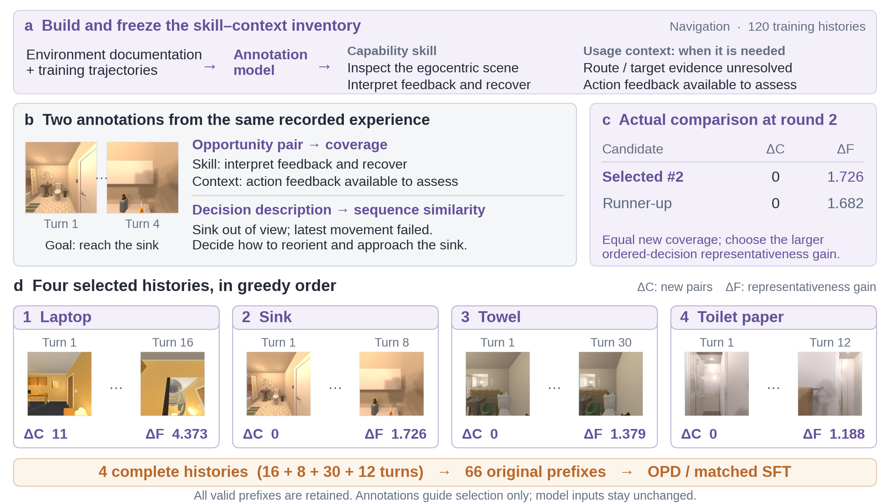

# Method and data contracts

## Representative selection in the paper

The study asks how much interaction experience is needed for visual-agent distillation. A selected trajectory set supports two uses: replay its fixed histories, or use its underlying task IDs for fresh online interaction. The selection overview below describes the paper; this release exposes precomputed examples rather than the selection implementation.



1. **Build a shared skill–context inventory.** An annotation model uses environment documentation and training trajectories to propose capabilities and observable situations requiring them, then merges synonyms and freezes a common vocabulary.
2. **Label opportunities.** For each decision, annotate evidence-supported skill–context pairs. A trajectory's coverage is their union. An opportunity means the capability is relevant; it does not require that the student demonstrated it successfully.
3. **Describe causal visual decisions.** A separate annotation path sees current screenshots, observations, earlier parsed actions, and feedback. It does not see the current response, future observations, final outcome, or hidden reasoning. Descriptions record goals, visual state, required decisions, relevant history, changes, and uncertainty.
4. **Select complete trajectories.** Field-tagged TF–IDF encodes descriptions. Monotonic sequence matching measures similarity while retaining decision order. Each greedy choice first maximizes new skill–context coverage, then representativeness gain, then uses immutable IDs to resolve ties. Keep at most one trajectory per task and every valid prefix of each selected history.

For trajectory $i$, let $C_i$ be its opportunity-pair set and $s(i,j)$ its ordered decision similarity to trajectory $j$. Over eligible candidates $E$, representativeness is

$$F(S)=\sum_{i\in E}\max_{j\in S}s(i,j),\qquad F(\varnothing)=0.$$

Each choice maximizes the following pair **lexicographically**, rather than adding two weighted scores:

$$\left(\left|C_j\setminus\bigcup_{i\in S}C_i\right|,\ F(S\cup\{j\})-F(S)\right).$$

After coverage saturates, representativeness determines the remaining choices. Success, response length, and execution status are not ranking criteria. Annotation models are `gpt-5.6-terra`/`gpt-5.6-luna`; the frozen Qwen3.5-27B **distillation teacher is a separate model**. Selection annotations are never injected into student or distillation-teacher prompts.

In the recorded Navigation example, the first choice covers all 11 observed pairs. Later choices improve representativeness; four of 120 trajectories retain 66 original prefixes. The corresponding Sokoban/SpatialGym K4 sets retain 10/21 prefixes. The diagram is a recorded example, not a claim that four histories cover every possible situation.

## Released training interface

The public boundary starts **after trajectory selection**. `prepare_data.py --episodes selected.json` reads every path supplied by the caller, without ranking trajectories or filtering by success. It rejects incomplete/infrastructure-error episodes and evaluation-split episodes. Selection labels never become model input.

A prefix ends at observation t: system, observation 0, original response 0, …, observation t. The response at t, future observations, rewards and final outcome are absent. Original earlier thinking and original image bytes are preserved. The prefix validator compares native token IDs, image pixels and grid shapes, and rejects excessive length rather than silently truncating the pool.

For offline OPD, sample a trajectory uniformly, then a turn uniformly: $p(i,t)=1/(|S|T_i)$, where $T_i$ is the number of turns in trajectory $i$. Thus long trajectories do not receive extra probability merely because they contain more turns. The student samples a new response y from its current policy. The frozen teacher scores exactly these response token IDs on the same multimodal prefix. The native Slime token advantage is:

```text
A_t = log p_teacher(y_t | prefix, y_<t) − log p_student_old(y_t | prefix, y_<t)
```

The coefficient is 1; there is no environment reward or additional reference KL. Native PPO-style clipping uses epsilon 0.2 with no advantage normalization; losses average tokens within each response, then responses within the batch. `mm_opd_checks.py` checks the signal against that difference. Native Slime performs the policy update. The tokenizer compatibility assumptions are specific to the released Qwen3.5 student/teacher pairing.

Matched SFT uses the same ordered prefix draws. A frozen teacher generates a response for each draw, using sampling seed `20261022 + draw_index`; the full response, including thinking and length-limited completions, is supervised. Prompt tokens have zero supervised weight. SFT uses native `sft_loss`, with advantage computation disabled. The saved collection response is **not** the SFT target.

An online OPD sample is an actually executed response, not a completed episode. Sixteen environment lanes retain their causal histories. Slime's native background worker overlaps generation and training, with at most one batch of unconsumed credit. Sampling-policy lag is checked to be at most one update; native truncated importance sampling uses bounds [0, 2]. Histories can cross policy versions. No outcome-based turn filtering is applied.

## Input schemas

- `mm-episode-v1`: `system`, `task`, `source`, `protocol_sha256`, `status`, and ordered `turns` with `observation`, exact `response`, and `next_observation`.
- Each text/image message is explicitly typed. Images use content-addressed `image_ref` records in stored episodes and absolute image paths in native training JSONL.
- `selected.json`: JSON array of episode paths relative to the manifest, supplied by the user. This list is the selection-module interface.
- `pool.jsonl`: every causal prefix of the selected episodes. `prefixes.jsonl`: the precommitted draw order.
- `config.json`: model path, recipe and budgets. `input-audit.json`: native processor checks, pool and draw SHA256.

The compact walkthrough uses anonymized IDs. Its prefix text/images are original, but its display JSON is not the internal episode schema. `--demo` converts that representation without interpreting or rewriting responses.
