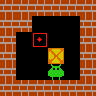

# MosaicDistill

**Multimodal Agent Distillation from a Few Representative Trajectories**

A companion repository for **Distilling Visual Agents from a Few Representative Trajectories**.

This release presents processed research examples and precomputed selection records. Read everything directly in the repository: no installation, webpage, model service, or GPU is required. Training and evaluation code is now available; see the repository README.

## Walkthrough

1. Start with a pool of recorded visual interactions. This example has **128 Sokoban candidate trajectories**.
2. Inspect the cached skill/context annotations and visual decision descriptions used for selection.
3. Follow the **four recorded representative choices** below.
4. Inspect the **10 fixed prefixes** extracted from those trajectories. Each prefix ends at the current observation, before its response.

In the training method, a student generates a new response at a sampled prefix, and a frozen teacher supplies token-level guidance. The files here show the saved inputs; they do not execute sampling, selection, or distillation.

## Four representative trajectories

These are the four recorded histories used in the paper's Sokoban K4 setting. Follow a trajectory link to see its observations, extracted actions, cached decision descriptions, and prefix links.

| Recorded rank | Trajectory | Initial observation | Saved prefixes | Newly covered skill–context pairs | Recorded representativeness gain |
|---:|---|:---:|---:|---:|---:|
| 1 | [C023](../examples/C023.md) |  | 5 | 6 | 9.184 |
| 2 | [C073](../examples/C073.md) |  | 2 | 1 | 2.646 |
| 3 | [C016](../examples/C016.md) |  | 1 | 0 | 3.345 |
| 4 | [C114](../examples/C114.md) |  | 2 | 0 | 1.892 |

The histories were collected by the original Qwen3.5-4B student. They retain unsuccessful actions and imperfect outputs; the original responses have not been rewritten into ideal solutions. Selection gains are stored selection statistics, not task success rates. Full-precision records are in [selection.json](../data/selection.json).

## What a fixed prefix contains

A prefix contains the original system message, earlier observations and responses, and the current observation. Earlier reasoning is retained. The current response and future observations are excluded. See [P01](../data/prefixes/P01.json) for a first-turn input and [P02](../data/prefixes/P02.json) for an input with interaction history.

Skill labels and cached decision descriptions are used for selection only. They are **not inserted into either the student or distillation-teacher prefix**. Training samples a selected trajectory uniformly, then samples one of its turns uniformly; this repository displays the resulting saved input records only.

## Contents

| File or directory | Contents |
|---|---|
| [examples/](../examples/) | Four readable trajectory walkthroughs |
| [data/candidates.json](../data/candidates.json) | Summaries and cached annotation previews for all 128 candidates |
| [data/selection.json](../data/selection.json) | Four precomputed choices and recorded gains |
| [data/vocabulary.json](../data/vocabulary.json) | Saved skill and context vocabulary |
| [data/trajectories/](../data/trajectories/) | Complete stored responses and observations for the four selected trajectories |
| [data/prefixes/](../data/prefixes/) | Ten saved model inputs |
| [images/](../images/) | Original observation images referenced by the selected examples |
| [THIRD_PARTY.md](../THIRD_PARTY.md) | Environment and asset acknowledgments |

Image paths in JSON are relative to the repository root. Displayed turn numbers start at 1; JSON `turn_index` starts at 0. Candidate IDs are aliases. Image pixels and model-message text are retained, while account names, machine paths, and unrelated run metadata are omitted. Nonselected candidates have annotation previews only; their images and complete histories are not included in this compact release.

This walkthrough displays precomputed examples. Training, environment and evaluation code are documented in the repository README; selection code remains withheld.
