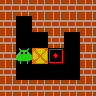
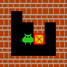

# Recorded trajectory C016

[Back to overview](../README.md)

Selection rank: 3. Recorded success: **true**. Turns: 1.

[Complete original response and observation records](../data/trajectories/C016.json).

Each turn shows the original action and observations, its saved causal prefix, and the decision annotation used for selection. Prefixes end before the displayed response; selection annotations remain separate from model inputs.

## Turn 1

**Observation before the response**



**Extracted action(s)**

```text
["right"]
```

Recorded format check: `true`.

[Exact saved input prefix P08](../data/prefixes/P08.json)

**Cached decision description used for selection**

> Decide whether and how to push the box toward the adjacent target while respecting that boxes can only be pushed, not pulled.

**Observation after the recorded response**


