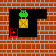
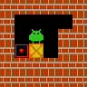
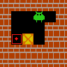
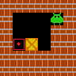

# Recorded trajectory C023

[Back to overview](../README.md)

Selection rank: 1. Recorded success: **false**. Turns: 5.

[Complete original response and observation records](../data/trajectories/C023.json).

Actions and descriptions below are recorded outputs, not corrected solutions. Prefixes stop before the response of the displayed turn.

## Turn 1

**Observation before the response**



**Extracted action(s)**

```text
["down"]
```

Recorded format check: `true`.

[Exact saved input prefix P01](../data/prefixes/P01.json)

**Cached decision description used for selection**

> Decide how to reposition the player and begin pushing the visible box toward the lower-left target without trapping it against walls or in a non-target corner.

This annotation is not appended to the model input.

**Observation after the recorded response**



## Turn 2

**Observation before the response**


**Extracted action(s)**

```text
["right", "up"]
```

Recorded format check: `true`.

[Exact saved input prefix P02](../data/prefixes/P02.json)

**Cached decision description used for selection**

> Determine a push-safe way to move the box onto the target. The player is currently above the box, whereas a leftward push toward the target would require access to the box's right side; wall and floor access around the box must be considered because boxes cannot be pulled.

This annotation is not appended to the model input.

**Observation after the recorded response**



## Turn 3

**Observation before the response**


**Extracted action(s)**

```text
["down"]
```

Recorded format check: `false`.

[Exact saved input prefix P03](../data/prefixes/P03.json)

**Cached decision description used for selection**

> Decide how to reposition the player and push the box toward the target while respecting walls and Sokoban's no-pulling constraint; in particular, a push that moves the box leftward would require access to its right side.

This annotation is not appended to the model input.

**Observation after the recorded response**


## Turn 4

**Observation before the response**


**Extracted action(s)**

```text
["right", "down"]
```

Recorded format check: `true`.

[Exact saved input prefix P04](../data/prefixes/P04.json)

**Cached decision description used for selection**

> Decide how to reposition the player to the box's right-side pushing position and then push the box left toward the target, while respecting that boxes can be pushed but not pulled and avoiding wall blockage.

This annotation is not appended to the model input.

**Observation after the recorded response**



## Turn 5

**Observation before the response**


**Extracted action(s)**

```text
["right", "down"]
```

Recorded format check: `true`.

[Exact saved input prefix P05](../data/prefixes/P05.json)

**Cached decision description used for selection**

> Decide how to reposition the player relative to the box so that a legal push can move it toward the target, while respecting walls and the fact that boxes can be pushed but not pulled.

This annotation is not appended to the model input.

**Observation after the recorded response**


