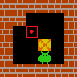
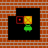
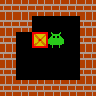

# Recorded trajectory C073

[Back to overview](../README.md)

Selection rank: 2. Recorded success: **true**. Turns: 2.

[Complete original response and observation records](../data/trajectories/C073.json).

Each turn shows the original action and observations, its saved causal prefix, and the decision annotation used for selection. Prefixes end before the displayed response; selection annotations remain separate from model inputs.

## Turn 1

**Observation before the response**



**Extracted action(s)**

```text
["up"]
```

Recorded format check: `true`.

[Exact saved input prefix P06](../data/prefixes/P06.json)

**Cached decision description used for selection**

> Decide how to reposition and push the box toward the target without pushing it into an unrecoverable wall-bound position.

**Observation after the recorded response**



## Turn 2

**Observation before the response**


**Extracted action(s)**

```text
["right", "up", "left"]
```

Recorded format check: `true`.

[Exact saved input prefix P07](../data/prefixes/P07.json)

**Cached decision description used for selection**

> Decide how to reposition the player and push the box toward the upper-left target without pushing it into a wall or into a position from which it cannot be moved onto the target.

**Observation after the recorded response**


