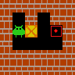
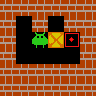
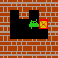

# Recorded trajectory C114

[Back to overview](../README.md)

Selection rank: 4. Recorded success: **true**. Turns: 2.

[Complete original response and observation records](../data/trajectories/C114.json).

Each turn shows the original action and observations, its saved causal prefix, and the decision annotation used for selection. Prefixes end before the displayed response; selection annotations remain separate from model inputs.

## Turn 1

**Observation before the response**



**Extracted action(s)**

```text
["right"]
```

Recorded format check: `true`.

[Exact saved input prefix P09](../data/prefixes/P09.json)

**Cached decision description used for selection**

> Decide how to position and move the player to push the box toward the target while avoiding an irreversible wall-bound box position; the player is visibly on the box's left side and the target is on its right.

**Observation after the recorded response**



## Turn 2

**Observation before the response**


**Extracted action(s)**

```text
["right"]
```

Recorded format check: `true`.

[Exact saved input prefix P10](../data/prefixes/P10.json)

**Cached decision description used for selection**

> Determine how to advance the box onto the adjacent target without creating an irreversible box position.

**Observation after the recorded response**


